

<picture><source media="(prefers-color-scheme: dark)" srcset="assets/hero-dark.svg"></picture>

<picture><source media="(prefers-color-scheme: dark)" srcset="assets/social-l-dark.svg"></picture><a href="https://t.me/sql2b2t"><picture><source media="(prefers-color-scheme: dark)" srcset="assets/social-1-dark.svg"></picture></a><a href="https://discord.com/sql.developer"><picture><source media="(prefers-color-scheme: dark)" srcset="assets/social-2-dark.svg"></picture></a><picture><source media="(prefers-color-scheme: dark)" srcset="assets/social-r-dark.svg"></picture>

<picture><source media="(prefers-color-scheme: dark)" srcset="assets/about-dark.svg"></picture>

<picture><source media="(prefers-color-scheme: dark)" srcset="assets/stack-dark.svg"></picture>

<a href="https://github.com/sql2b2t/collective-client"><picture><source media="(prefers-color-scheme: dark)" srcset="assets/project-collective-client-dark.svg"></picture></a>&nbsp;<a href="https://github.com/sql2b2t/collective-addon-template"><picture><source media="(prefers-color-scheme: dark)" srcset="assets/project-collective-addon-template-dark.svg"></picture></a>

<a href="https://github.com/sql2b2t/collective-scripts-template"><picture><source media="(prefers-color-scheme: dark)" srcset="assets/project-collective-scripts-template-dark.svg"></picture></a>&nbsp;<a href="https://github.com/sql2b2t/b2xy"><picture><source media="(prefers-color-scheme: dark)" srcset="assets/project-b2xy-dark.svg"></picture></a>

<picture><source media="(prefers-color-scheme: dark)" srcset="assets/stats-dark.svg"></picture>

<picture><source media="(prefers-color-scheme: dark)" srcset="assets/streak-dark.svg"></picture>

<picture><source media="(prefers-color-scheme: dark)" srcset="assets/wave-dark.svg"></picture>

<a href="https://github.com/sql2b2t?tab=repositories"><picture><source media="(prefers-color-scheme: dark)" srcset="assets/button-1-dark.svg"></picture></a>

